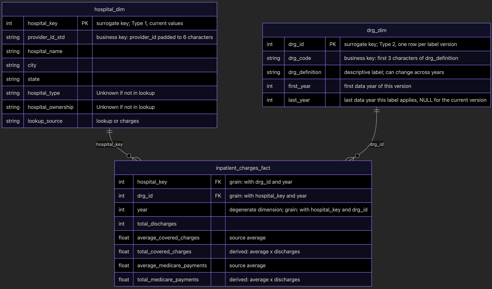

# 1. Establish the question and check the source

## Introduction and Question

In P0 I defined my audience as employer benefits analysts, whose need is to compare the differing hospital charges for
the same type of inpatient services and how those charges compared to what Medicare paid. This will be used to prioritize
hospitals for in-network negotiation.

Material changes from P0 are:
- The question has been reframed as historical charge and Medicare-payment benchmarking and not current pricing.
- Consideration to use overall rating as a criteria has been dropped due to a significant amount of missing data (2,006/5,336 ~ 38%).
- I checked the hospital join and change in DRG from 2013-2014, and updated my strategies for both as covered below.

For P1 the primary analytical question is:
- Within a given state, which hospitals have historically charged much more or less than others (to be defined later in
  P2) in that state for the same type of stay?
The supporting question is:
- Do hospitals with larger charge to payment gaps share traits, like hospital type or ownership?

## Source Profile

The source objects I plan to use were catalogued in P0 as follows:
- **Project and Dataset for all:**
  - `bigquery-public-data.cms_medicare`
- **Tables (and row counts):**
  - `inpatient_charges_2011`: 163,065
  - `inpatient_charges_2012`: 157,747
  - `inpatient_charges_2013`: 153,600
  - `inpatient_charges_2014`: 202,656
  - `inpatient_charges_2015`: 201,876
  - Total Inpatient Charges Count: 878,944
  - `hospital_general_info`:    5,336
- **Row meaning:**
  - `inpatient_charges_*`: One row is one hospital (`provider_id`) and one type of stay (`drg_definition`) for that year
  - `hospital_general_info`: One row is a single hospital (`provider_id`)
- **Time coverage:**
  - Charges: 2011-2015 (the year appears only in the table name).
  - Lookup: as-of date unknown (table created 2017, last modified 2021).
- **Candidate Identifiers:**
  - `inpatient_charges_*`:
    - Source fields: `provider_id` and `drg_definition`. Together they are unique within each yearly table.
    - For the grain I derived: the year (added from the table name), the hospital ID left-padded to six characters
       (to match the lookup), and the 3-digit DRG code (the first three characters of `drg_definition`). The rest of
       `drg_definition` is a descriptive label that can change across years.
  - `hospital_general_info`:
    - `provider_id` -> The unique hospital ID with no values missing or duplicated.

## Grain Test

The queries I used for the grain test and supporting checks are in [sql/01_source_profile.sql](../sql/01_source_profile.sql).
This runs as a single script due to the initial temp table creation, which I used to improve performance. 

I have identified the grain as: year, hospital (padded `provider_id`), type of stay (3-digit prefix of `drg_definition`).
The expected count was identified in the source profile above from P0, and is from summing all the yearly counts.

| Check         | Expected | Observed |
|---------------|----------|----------|
| Source rows   | 878,944  | 878,944  |
| Missing key   | 0        | 0        |
| Repeated keys | 0        | 0        |

### Supporting Checks

- I checked that padding the provider_id to support the joins does not change the hospital key count.
- I also confirmed that every DRG follows the 3-digit prefix code pattern.
- I verified that within each year, every DRG with the same 3-digit code has the same long text label.

## One Data Issue

One data issue that I ran into was around the hospital lookups.

- I found that the join matched only around 75% of the hospitals per year.
- When I dug in with more investigation, I found that the charge tables drop the leading zeros on provider_id, whereas
  the lookup is uniformly six characters. To try to fix that I left-padded the provider_id with 0s to get to a consistent
  6-digit length, after which the match rates jumped to between 89-93%.
- However, I still have the approximately 9% of hospital-years unmatched (1,476 of 16,450). So I needed to try to explain
  this continuing discrepancy. I took a few examples that were not finding a match by provider_id and tried to search the
  hospital table for records with the same ZIP or similar name. I did this to check whether hospitals might have
  shifted IDs over time, but did not find anything that supported that possibility.
- I also checked missing hospital lookups by both year and state, to see if any illuminating patterns emerged.
  - Pattern by year: the unmatched share falls over the years from about 11% to 7%.
  - Pattern by state: the unmatched rates run from 0% to 17% against 9% overall. WV and WY are about 17% (on small
    counts: 26 of 152 and 9 of 54). TX has the highest unmatched count (242 of 1,496) and about 16%. Six states have
    none. It's not clear to me if the variation I am seeing has any significance or is just random.
- A hypothesis is that these providers got removed from the master list at some point, or were never added in the first
  place for some other reason.
  - I do see the match rate increase year-over-year which could be consistent with hospitals from older years being more
    likely to be dropped from the master list due to closure, dropping from Medicare service, or other reasons.
  - However, this is a guess, and I am not able to determine the root cause for this variation.
- One consequence of this data issue is that when the expected hospital lookup fields like state, type, ownership, etc.
  are missing for these hospitals I would not get accurate results when attempting to answer my primary and supporting
  questions identified above.
- I believe I can partially address this with how I load the hospital lookup in my model, where I can use the existing
  hospital information captured in the charges table to backfill the hospital lookups with otherwise missing providers.
  - This would give name and geographical information, but not type and ownership.
  - I will plan to label any dashboards using missing attributes to indicate that not all charge data is used when
    filtering by type and ownership.
- **Limitation:** I measured this gap only in hospital counts. I did not measure what share of discharges or charges
  belongs to the unmatched hospitals, so I don't know how much of the charge data it affects. Depending on how large
  the unmatched hospitals are, the effect on results could be smaller or larger than the 9% suggests.

## Additional Supporting Check: DRG Coverage

I started by checking if DRG 3-digit codes were consistently represented across all the charge data years:

| years_present | drg_count |
|---------------|-----------|
| 1             | 55        |
| 2             | 432       |
| 3             | 6         |
| 4             | 5         |
| 5             | 94        |

I see 592 distinct codes in total, with the count being the number of codes that are present for the number of years listed.
This was not completely surprising to see, since from my earlier source profile exercise I had seen the number of distinct
DRG labels per year jump a large amount from 100 in 2011-2013 to 564 in 2014 and 563 in 2015.

I also checked if the same code changes its full description within or across years; I did not see any change within a
year, but found six (example 065 shown below) that had the same prefix code but different full DRG labels across years:

| year | drg_code | drg_definition                                                             |
|------|----------|----------------------------------------------------------------------------|
| 2012 | 065      | 065 - INTRACRANIAL HEMORRHAGE OR CEREBRAL INFARCTION W CC                  |
| 2013 | 065      | 065 - INTRACRANIAL HEMORRHAGE OR CEREBRAL INFARCTION W CC OR TPA IN 24 HRS |

At this point I fell back onto a general internet search to try to learn what might explain this unusual pattern of
yearly total count and label changes; I then discovered some supporting information on some websites that informed me
of the following possible explanations for my observations:
- From 2011-2013 only the top 100 DRGs for that year were reported. This is supported in the following link:
  - [Source](https://www.cms.gov/research-statistics-data-and-systems/statistics-trends-and-reports/medicare-provider-charge-data/downloads/inpatient_methodology.pdf)
- Codes are added, removed, split, and merged year-over-year. This is supported in the following links:
  - [Source 1](https://www.cms.gov/priorities/innovation/files/x/bpciadvanced-episodecreationspecs-yr1-2-app.pdf)
  - [Source 2](https://www.federalregister.gov/d/2014-18545/p-1236)
So I think this adds evidence to support an expectation that DRGs can fluctuate from year-to-year, and I will try to handle
this by only comparing codes present in the years being compared within my dashboard product. For 2011-2013, a
code that is missing for a year means it was not among that year's top 100, not that no discharges occurred, so I will
not treat a missing code as zero activity in those years.

## Conclusion

In conclusion, I believe I have shown that the grain I have declared is supported:
- The grain is one row per year, hospital, and stay type (DRG) code, with no duplicate or missing keys.
- There are four qualifications to the grain.
  - The values are averages per hospital, stay type, and year.
  - A stay type DRG code's meaning can drift across years.
  - The stay type DRG set changes across years.
  - The share of discharges affected by the missing lookup hospitals was not measured.
- The join gap caused by missing hospitals in the source lookup affects some available hospital attributes, but not the grain.

# 2. Define the model and predict a history consequence

## Business process, fact type, and grain

The business process is Medicare inpatient billing and payment, reported annually by hospital and stay type.

For my fact table I selected a periodic snapshot. Since my source data already consists of pre-aggregated
annual summaries, this aligns with how periodic snapshot fact tables were presented in class as containing one row per
entity or process at a regular interval. The source data naturally fits in this scheme.

One row represents one hospital's Medicare inpatient activity for one stay type (DRG) in one data year.

## One Consequential Modeling Choice

One modeling choice of consequence that I made was to add totals columns to the fact table, since the provided data was
given as yearly averages. By adding these, I will simplify how ratios can be calculated and compared at query time since
they will already be adjusted by the total discharges (average x discharge count). This will enable summation with other
hospitals of different sizes. In other words, averages can't be summed or averaged across hospitals of different sizes
within a state, but these totals would allow us to build the comparison of individual hospital averages against the
overall state average accurately.

A trade-off of this is that my calculated totals could be different from the actual totals, due to the rounding in the
source averages, the effect of which I have not measured. However, I will keep the source averages so that the original
value is always available if required.

## Model

### Diagram

### Key Decisions

| Decision             | Answer                                                                                           |
|----------------------|--------------------------------------------------------------------------------------------------|
| Principal Fact       | inpatient_charges_fact                                                                           |
| Dimensions Needed    | hospital_dim, drg_dim, year (degenerate)                                                         |
| Key Strategy         | Fact will have foreign keys, Dimensions will have surrogate keys                                 |
| Important Measures   | total_covered_charges, total_medicare_payments, total_discharges                                 |
| Important Attributes | hospital_name, state, hospital_type, hospital_ownership, drg_code, drg_definition, lookup_source |
| Relationships        | A one-to-many relationship between each dimension and the fact                                   |

### Important Notes

The `lookup_source` column indicates if the hospital dimension record was loaded from the `hospital_general_info` source
or if it was filled in from the charges table. For hospitals that were not present in `hospital_general_info`:
- A dimension record is created from the latest record in the charges table by year, name alphabetically, and a hash of
  the row values to break any remaining ties.
- Charges only contains a subset of hospital attributes such as ID, name, city, and state.
- I am only able to populate those columns in the dimension table.
- The rest will be marked as Unknown.

I will load all hospitals into the dimension, even those without corresponding charges records (I found at least 1,875,
from 5,336 minus 3,461). This is for two main reasons: First, it simplifies the loading logic. Second, it allows for
easier backfilling of charges data if new years were to become available. Serving will remove these hospitals so that
they don't appear in the reports.

I am defining `year` as a degenerate dimension since time is only available at one level (year) with only 5 values.

I decided to leave out attributes from hospital such as rating, mortality, safety, and other lookup columns due to them
not being necessary for the primary and supporting questions. For rating specifically, I saw that it has a large number
of values (2,006 of 5,336) showing "Not Available" in the source data.

## Primary Question Trace

We trace the primary question of historical stay type charge comparisons within a state compared to others as follows:

| Step        | Trace                                                                     |
|-------------|---------------------------------------------------------------------------|
| Fact        | inpatient_charges_fact                                                    |
| Measures    | total_covered_charges, total_medicare_payments, total_discharges          |
| Calculation | SUM(total_covered_charges) / SUM(total_medicare_payments)                 |
| Dimensions  | hospital_dim (state, hospital_name), drg_dim (drg_code), year (from fact) |
| Filters     | state, drg_code, year(s)                                                  |
| Result      | hospital ratio vs state ratio                                             |

For the supporting question, do hospitals with larger charge to payment gaps share traits, we could filter with hospital
type or ownership to see how comparison ratios change.

Queries will group by `drg_code` and not `drg_id`, due to the type 2 dimension and a single code potentially spanning
multiple dimension records.

Views of data across years will only use the DRG codes that exist in all those years.

## History Decision and Prediction

### Changing Attribute and Planned Treatment

I am choosing to model the DRG dimension as a type 2 dimension. This seems appropriate as I have confirmed in my source
profiling that some DRG codes change labels across years, but never within a year. So modeling `drg_dim` as a type 2
dimension allows me to capture these changes over time, and show the value of the label as-of a specific year.

The dimension will have one row per version of the 3-digit prefix from the DRG label, stored in `drg_code`, where a new
version begins whenever a label differs from that code's label in the previous year it was reported. The earlier
version is end-dated. If a label reverts to an earlier wording, it becomes a new version with its own `drg_id`. The
current version of the dimension will have a NULL `last_year` value. A version ends the year before the next version of
that code begins, so a code's versions are unbroken and never overlap, even across years when the code was not reported.

For DRG, my source identifier will be the 3-digit prefix from the DRG label, which I call `drg_code`, and the warehouse
key will be a surrogate key, `drg_id`, which I will generate for each version of a `drg_code`.
For hospital, my source identifier will be the padded provider_id called `provider_id_std` and the warehouse key will be
a surrogate key, `hospital_key`, which I will generate when I load the record.

I chose type 2 over type 1 (which would overwrite a single version of the DRG row with new label text) to allow users to
see what label was true as-of the charge year, and how it has changed over time.

### Date Role and Shared Dimension

My shared dimension will be the `drg_dim` with the `drg_code` shared across all years even if the full source DRG label
changes from year-to-year. The `year` on the fact table serves as the date role, and selects which version of the
dimension record to use for the label by applying a comparison to the dimension version first and last years. To manage
the fact that current dimension versions will have a NULL `last_year`, I will use a selection rule like this: 
`first_year <= year AND (last_year IS NULL OR year <= last_year)`.

Since not every DRG was available in 2011-2013 (due to those years only containing the top 100 for that year) a version's
date range can include years when that code has no fact rows.

### Predicted Effect on the Primary Question

For my primary question (one state, one stay type, one year), every hospital's rows for a given code share the same
label version, so the hospital and state ratios are identical under all three treatments below. The choice changes what
an analyst sees in multi-year views and in which label is displayed.

For example:

| Treatment of code 065        | What happens                                                        | Effect                                                                                                             |
|------------------------------|---------------------------------------------------------------------|--------------------------------------------------------------------------------------------------------------------|
| Key by full label            | 065 becomes two stay types, one for 2011-2012 and one for 2013-2015 | Single-year rankings are unchanged. A multi-year view splits 065 into two groups with no overlapping years         |
| Code key, Type 1             | One stay type, with the latest label on every year                  | Grouping is correct, but 2011-2012 rows display wording that did not exist yet, hiding that the definition changed |
| Code key, Type 2 (my choice) | One stay type, two label versions                                   | Grouping is correct, each year shows its own label, and the dashboard can flag that the definition changed         |

My prediction is that for a multi-year view of code 065, the full-label key splits it into two groups, while the code key
with Type 2 shows one group with a visible definition change in 2013. The supporting question (hospital type and
ownership) is not affected by this choice.

The primary question can also be asked across years, for example a hospital's ratio against its state for one stay
type from 2011 to 2015, and that multi-year version is the one this history decision affects.

### Behavior to Implement or Test by P3

For code 065, I will check the model for the following:
- Grouping fact rows by `drg_code` returns one group covering 2011-2015, and grouping by full label returns two groups
  (2011-2012 and 2013-2015).
- Rows joined through `drg_dim` show the old label for 2011-2012 and the new label for 2013-2015.
- The fact row count for code 065 equals the source row count for 065 across all five years.
- Every fact row joins to exactly one `drg_dim` version, so the fact row count equals the source row count (duplication
  from overlapping versions would break that).
- For every code, version spans don’t overlap.

### Not Being Modeled With History

`hospital_dim` is treated as Type 1 (one row per hospital, current values). That lookup is a single snapshot with an
unknown as-of date, and the charge tables give no evidence of when a hospital's name or state changed, so I am not
adding history there. I haven't measured how often a hospital's name or state differs across years.

# 3. Plan the build and its checks

## Layers

| Layer   | What it will do                                                                                                                                                                                                                                                                                           | Object Names                                                                                            |
|---------|-----------------------------------------------------------------------------------------------------------------------------------------------------------------------------------------------------------------------------------------------------------------------------------------------------------|---------------------------------------------------------------------------------------------------------|
| Raw     | Stores snapshots of source data in my own dataset, with a load_date TIMESTAMP column                                                                                                                                                                                                                      | inpatient_charges_*_snapshot hospital_general_info_snapshot                                          |
| Curated | Stores the fact and dimension tables, provides type 2 DRG history                                                                                                                                                                                                                                         | inpatient_charges_fact hospital_dim drg_dim union_charges_stg hospital_stg rejected_rows |
| Serving | Provides a view that has hospital attributes (type, ownership, lookup_source), DRG code/label, and final calculations used by dashboards. Removes never-billed hospitals. Cross-year views are restricted to codes present in every selected year (enforced in the dashboard query, see run order step 9) | inpatient_charges_totals_and_ratios                                                                     |

## Preliminary Run Order

Here's the preliminary run order I have in mind:

1. Copy source tables into Raw snapshots in my own dataset.
2. Load latest Raw snapshot of hospital data into staging table.
3. Load union of latest Raw snapshot of each charges year table into a Curated working area union staging table.
4. Check inputs, move any rows with any bad data or rule violations to a `rejected_rows` table in Curated.
5. Load Curated dimensions with data confirmed for inclusion.
6. Load Curated fact with data confirmed for inclusion.
7. Perform checks and tests on Curated data to ensure Serving will be updated with intended data. 
8. Serving view will reflect new data automatically, updating what is seen on the dashboards.
9. The dashboard query will restrict to codes present in every selected year (mechanism to be decided later in P2, but
   possibly a filter in the dashboard query or some other function).
10. Run Serving validation to ensure calculations and grain appear correct.

## Field Trace Example

The field that I will trace is `total_covered_charges`. Here is a description of how it moves through the pipeline:

1. Source fields `average_covered_charges` and `total_discharges` exist in CMS source tables `inpatient_charges_*`.
2. Source table with these fields copied into my Raw dataset snapshot copy.
3. The Raw latest snapshot tables for each year are combined via a union into an all years staging table (stored in Curated).
4. Checks are run in Curated to filter out any charges rows that violate the rules. Some rules include:
   - Key fields not null
   - DRG label matches the three-digit pattern
   - Discharges and charge fields not null
   - Medicare payments greater than zero
5. Charge data with those fields is loaded into the Curated fact table `inpatient_charges_fact`, into columns of the
   same name `average_covered_charges` and `total_discharges`. The hospital lookup to set `hospital_key` is done using
   the padded ID, and the DRG lookup to set `drg_id` is done using the DRG code and year check.
6. As part of the same update as step 5, those two fields are multiplied via `total_discharges x average_covered_charges`
   for each row and that value is loaded in the same Curated fact table into `total_covered_charges` field.
7. The Serving view will reflect the new `total_covered_charges` data.
8. The Serving view sums up the total_covered_charges and total_medicare_payments by hospital and by state
   for any provided stay type and years, divides `total_covered_charges` by `total_medicare_payments`, and the dashboard
   shows hospital ratio against state ratios.

## Risks and Checks

Three risks and corresponding checks that come to mind are:

| Risk                                                        | Planned check                                                                                                                                                                                                                                                                                                           | Expected result                                                                                                             | Where            |
|-------------------------------------------------------------|-------------------------------------------------------------------------------------------------------------------------------------------------------------------------------------------------------------------------------------------------------------------------------------------------------------------------|-----------------------------------------------------------------------------------------------------------------------------|------------------|
| 1: Fact rows lost or duplicated when joining to dimensions. | Fact row counts + rejected total = source total. Every fact row matches only one row in `hospital_dim` and one row in `drg_dim`.                                                                                                                                                                                        | Counts equal, no dupes, expected rejects = 0                                                                                | Curated, step 7  |
| 2. The hospital vs state comparison is wrong.               | a. Serving ratios for each state match the same calculated from Raw, for a sample of states with large size difference as well as DRGs. b. For sample multi-year requests (2011-2015 and 2013-2015), I will count the DRG codes in Serving view output that have no fact rows in one or more of the requested years. | a. Match within reasonable FLOAT rounding b. Out of set codes = 0                                                        | Serving, step 10 |
| 3: Missing hospital attributes due to backfilling           | Count distinct fact hospitals per year with `lookup_source = "charges"`.                                                                                                                                                                                                                                                | Compare to unmatched hospital counts per year from the task 1 match query: 2011:370, 2012:337, 2013:299, 2014:258, 2015:212 | Curated, step 7  |

## Access Decisions

My traced field `total_covered_charges` comes from public hospital-level aggregates, and no patient data is included
as part of this or is ever shown to analysts. So I don't feel that any special access control is needed.

Hospital name will appear alongside the total covered charges. However, potentially sensitive hospital information like
phone numbers and address are not loaded, so even if it was decided those required non-public handling it wouldn't be an issue.

The intended user of the field is the employer benefits analyst, the owner for the objects in the project schema is me
whereas the source objects are owned by CMS.

The traced field `total_covered_charges` will reappear in the audience output, and this is by design since the ratios
show on the dashboard.

## Largest Remaining Limitation

I think the largest remaining limitation is where hospital attributes, like type and ownership, are missing for about
9% of hospital-year data due to not being present in the source `hospital_general_info` table. Additionally, the values
that are present are from a snapshot of an unknown as-of date. This is a limitation from the source system that I am not
able to fix.

My primary question is able to compare hospitals within a state using fields that are available for every hospital.
However, my supporting question is only able to compare fields that are current as-of the unknown snapshot date.

## First P2 Build Step 

My first concrete P2 build step is to load the six Raw snapshot tables and confirm the counts of each table match the
source counts: 163,065, 157,747, 153,600, 202,656, 201,876, and 5,336.

# 4. Diagnose and revise the plan

During the in-class peer review, I shared an overview of my plan and solicited feedback. The memo instructed by the peer
diagnosis exercise is below.

## P1 change memo

- I did not receive any specific feedback other than some questions asking to explain why I had the specific year and
  DRG code limitations that I have outlined.
  - I showed how the datasets were both restricted to just a small set of years (2011-2015) and also explained how the CMS
    dataset changed from only top 100 DRGs for a year to all in 2014.
  - So no changes were needed based on those questions.
- Peer review did not surface any other needed modifications, so I don't have anything else to call out or highlight for
  that portion.
- Most important remaining uncertainty:
  - I believe the main uncertainty I have is around incomplete dimension lookups and attributes, specifically with the
    hospital type and ownership fields that are unavailable for about 9% hospital-years.

## AI/tool accountability

I used AI to help me review and clean up my work throughout P1, as I did in P0. I treated its output as leads to check, not as
evidence, and I remain responsible for every claim in this plan.

### What I used it for
- Interpreting the P1 requirements and outlining each task.
- Drafting SQL patterns that I then adapted and ran: the combined-year grain check, the hospital join match-rate query,
  and the DRG coverage queries.
- Drafting the Mermaid source for the model diagram, which I edited and exported to `model.png`.
- Searching for background on DRG changes and on BigQuery materialized view limits.
- Reviewing and suggesting edits to my wording in each section.

### What was my own work
- Running every query and recording the results, and tracing the join gap to the dropped leading zeros.
- Finding the CMS methodology document that explains the top-100 DRGs in 2011-2013.
- Choosing the DRG code (not the label) as the key, designing the end-dated Type 2 versioning for `drg_dim`, and
  deciding to backfill hospitals missing from the lookup using the charge tables.

### How I verified
- I ran all queries in BigQuery and compared the results to the plan: the 878,944 source rows, the grain check counts,
  the match rates by year, and the DRG coverage distribution.
- I spot-checked unmatched hospitals in the console and did not copy any source rows into the repository.
- I checked the CMS methodology document myself.
- I checked the BigQuery documentation on materialized views before deciding not to use one.

### Where AI output was wrong or needed correcting
- The AI said both `provider_id` columns were the same type, so no conversion was needed. My query showed the
  charge tables drop leading zeros, and I fixed the join by padding the ID to six characters.
- My P0 write-up said the overall rating was "Not Available" for every row, and I had not saved a query showing it. The
  review prompted me to rerun it, and it showed 2,006 of 5,336 hospitals (about 38%). I corrected P0 and removed the claim.
- The AI referenced a Defense Health Agency page to say there were no DRG revisions in 2013. My query showed code 065 changed
  its label text in 2013, so I relied on the CMS sources and my own result.
- I had planned a materialized view for Serving. The documentation shows materialized views do not support window
  functions or self-joins, which my hospital-versus-state comparison would need, so I changed the plan to a regular view.

### Suggestions I did not adopt
- Taking `state` from the charge tables instead of `hospital_general_info`. I kept the lookup as the source and use the
  charge tables only to backfill the hospitals it is missing.
- Measuring the share of discharges belonging to unmatched hospitals, and comparing the charge-to-payment ratio of
  matched and unmatched hospitals. I judged these beyond what P1 expects, and the plan states the unmeasured share as
  a limitation.

